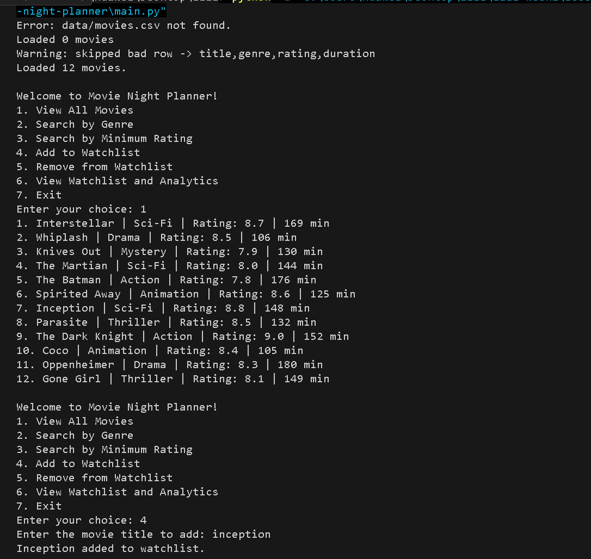
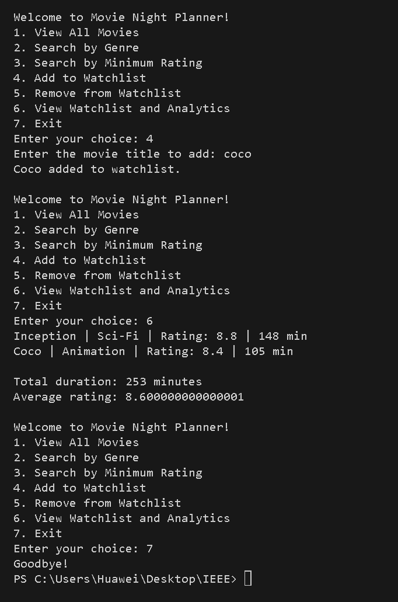
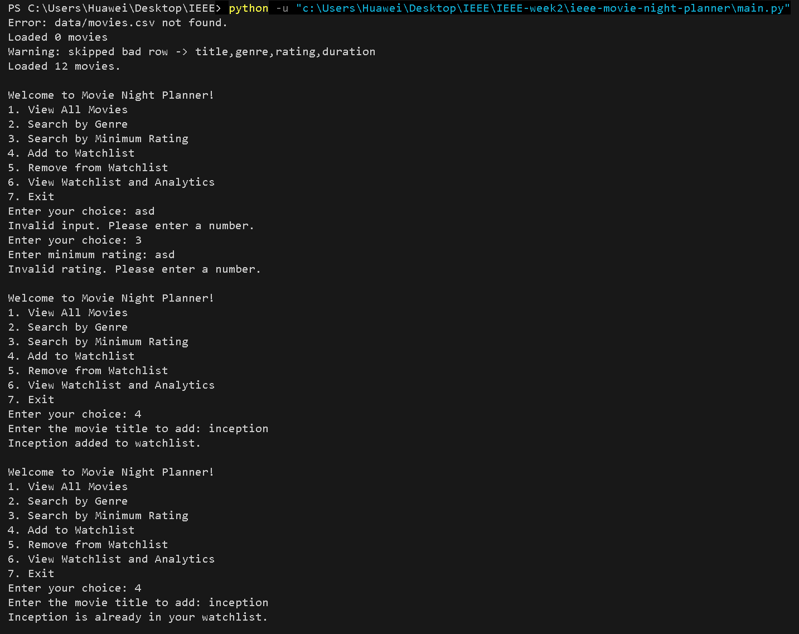

# Movie Night Planner

**Week 2: Advanced Python & Data Structures**
**IEEE LGU AI/ML Cohort One**
**AI/ML Leads: Abdullah Faisal & Alina Irshad**

Author: Muhammad Ahsan

## Project Overview
A movie recommendation and watchlist manager. It loads a library of movies from a CSV file, lets the user browse and filter them, and builds a personal watchlist with total duration and average rating analytics. Duplicate movies are blocked using a set.

## Concepts Implemented
- Object-Oriented Programming (Classes, Objects, Encapsulation)
  - `Movie` class stores one movie
  - `Watchlist` class manages the personal watchlist
- File Handling (movies are read dynamically from `data/movies.csv`, nothing is hardcoded)
- Error & Exception Handling (try/except for bad rows, a missing file and invalid user input)
- Data Structures (Lists, Sets)
  - A set of lowercase titles prevents duplicates in the watchlist
- List Comprehension (genre and rating filters)

## How to Run the Program
```
python main.py
```

## Dataset Information
`data/movies.csv` has 12 movies with the columns title, genre, rating and duration.

Error handling tests:
- Letters entered for the menu choice and the minimum rating
- Adding the same movie to the watchlist twice
- Adding a movie that is not in the library
- A missing data file

## Execution Screenshots & Proof
### Demo run




### Error handling test
